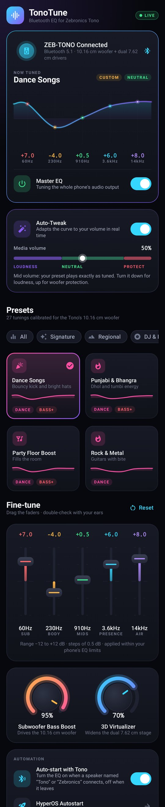
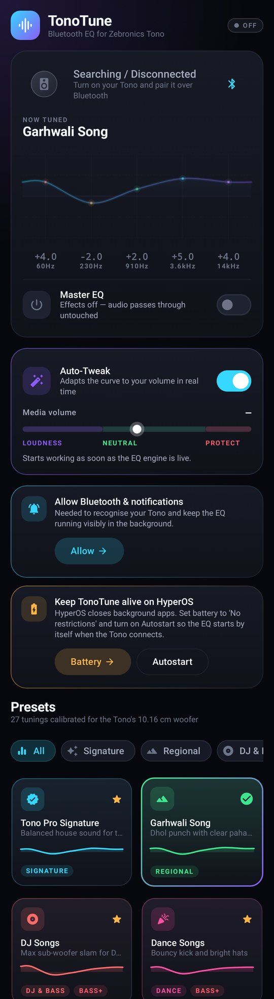

# TonoTune

System-wide Bluetooth equalizer for the **Zebronics Tono** 50W tower speaker (10.16 cm subwoofer + dual 7.62 cm full-range drivers, Bluetooth 5.1).
Built with Kotlin and Jetpack Compose (Material 3). Targets Android 16 (API 36) / HyperOS 3, tuned for the Poco X8 Pro Max (arm64-v8a).

| Live hero & Auto-Tweak | Fine-tune | Setup helpers |
|---|---|---|
|  |  |  |

## Install
1. Copy `dist/TonoTune-v1.0.0-release.apk` to the phone (SHA-256 in the `.sha256` file next to it).
2. Open it and allow "Install unknown apps" for your file manager.
3. Open TonoTune and allow **Nearby devices (Bluetooth)** and **Notifications**.
4. On HyperOS, tap **Battery → No restrictions** and **Autostart → on** in the "Keep TonoTune alive" card. Without this, Android 12+ blocks the EQ from starting by itself when the speaker connects, and TonoTune shows a one-tap "activate" notification instead.

## Features
- **27 presets calibrated for the Tono** (Tono Pro Signature, Garhwali Song, DJ Songs, Dance Songs and 23 more) with category filters.
- **Five fine-tune faders** (60 Hz, 230 Hz, 910 Hz, 3.6 kHz, 14 kHz, from −12 to +12 dB in 0.5 dB steps) with haptic ticks, plus rotary knobs for **Subwoofer Bass Boost** and **3D Virtualizer** (0–1000). Tweaks are saved, and **Reset** returns to the preset.
- **Auto-Tweak** (on by default) follows the media volume live:
  - below 35%: +1.5 dB at 60 Hz and +1.0 dB at 14 kHz (loudness)
  - above 80%: −1.5 dB at 230 Hz and Bass Boost at 80% (woofer protection)
- **Auto-start with Tono**: the EQ turns on when a Bluetooth device whose name contains "tono" or "zebronics" connects, and off when it disconnects.
- A **live frequency-response curve** that shows the actual output, Auto-Tweak included.
- **Engine diagnostics**: global session lock, attached app sessions, and the device's EQ band count and range.
- **Notification controls**: "Next preset" and "Turn off".

## How the audio engine works
- `TonoAudioService` is a `mediaPlayback` foreground service. It calls `startForeground` straight away in `onCreate`, and every `startForegroundService` call is wrapped so `ForegroundServiceStartNotAllowedException` falls back to the activation notification instead of crashing.
- `Equalizer`, `BassBoost` and `Virtualizer` are created with priority `Int.MAX_VALUE` on the global session `0`. A separate chain is created for every session that media apps announce with `ACTION_OPEN_AUDIO_EFFECT_CONTROL_SESSION`, and released on `CLOSE`.
- **HyperOS re-lock**: a watchdog runs every 8 s. It re-creates any chain that lost control (`hasControl()` or a control-status callback) to a system or other EQ.
- **Band mapping**: the 5-point curve is interpolated on a log-frequency axis onto the device's real band centres, so phones with something other than the AOSP 5 bands still get the right curve. Values are converted to millibels and clamped into `getBandLevelRange()`, so `setBandLevel` never throws.
- **Volume tracking**: a `Settings.System` ContentObserver plus the `VOLUME_CHANGED_ACTION` broadcast, with a 1.5 s poll as a fallback.

Note: `Virtualizer` is deprecated on API 36 but still works, and it is the only system-wide widener available. Some ROMs refuse global effects while Dolby or another EQ app holds them. The app then shows an "Audio effects blocked" card.

## Build
```bash
./gradlew testDebugUnitTest assembleDebug assembleRelease lintRelease
```
- JDK 17+, Android SDK platform 36. AGP 8.13.2, Kotlin 2.2.21, Gradle 8.14.3.
- Release signing reads `keystore.properties` (`storeFile`, `storePassword`, `keyAlias`, `keyPassword`), or the `TONO_KEYSTORE_PATH` / `TONO_KEYSTORE_PASSWORD` / `TONO_KEY_ALIAS` / `TONO_KEY_PASSWORD` env vars. Without them, the release build is signed with the debug key so it still installs.
- `ROBOLECTRIC_DEPS_DIR` (optional) points Robolectric at a pre-downloaded `android-all` jar for offline test runs.
- The UI screenshot tests write PNGs to `app/build/screenshots/`.

### CI (`.github/workflows/build-apk.yml`)
Runs on push to `main`, on pull requests, on `v*` tags and manually. It runs the unit tests, builds `app-debug.apk` and `app-release.apk`, runs lint, and uploads both APKs and the screenshots as artifacts. A `v*` tag also attaches the release APK to a GitHub Release.
For CI builds signed with your release key, add these repository secrets: `TONO_KEYSTORE_BASE64` (`base64 -w0 tonotune-release.jks`), `TONO_KEYSTORE_PASSWORD`, `TONO_KEY_ALIAS` and `TONO_KEY_PASSWORD`.

## Project layout
```
app/src/main/java/com/tonotune/app/
  audio/     EqPreset, TonoPresetLibrary (27 presets), EqMath + AutoTweakEngine, TonoEffectEngine, TonoDevices, EngineState
  service/   TonoAudioService (foreground service, re-lock, volume observer)
  receiver/  BluetoothTonoReceiver, AudioSessionReceiver, NotificationActionReceiver
  data/      TonoPreferences (DataStore)
  ui/        MainActivity, MainViewModel, TonoScreen, components/, theme/
```
